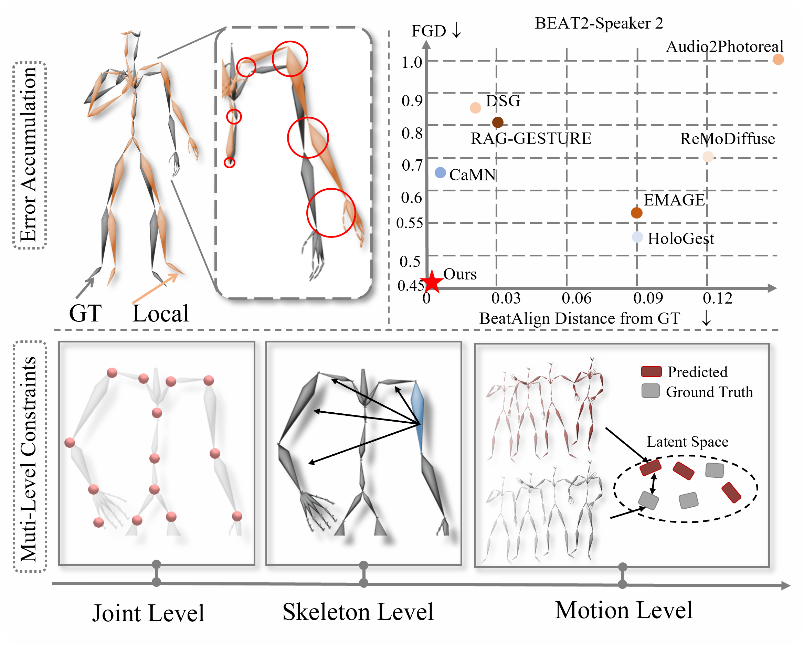

<div align="center">
<h2><font> </font></center> <br> <center>Mitigating Error Accumulation in Co-Speech Motion Generation via Global Rotation Diffusion and Multi-Level Constraints</h2>

[Xiangyue Zhang\*](https://xiangyue-zhang.github.io/), [Jianfang Li\*†](https://github.com/Xiangyue-Zhang/SemTalk), [Jianqiang Ren](https://github.com/JianqiangRen), [Jiaxu Zhang](https://kebii.github.io/)

<p align="center">
  <strong>✨AAAI 2026✨</strong>
</p>

<a href='https://arxiv.org/abs/2511.10076'></a> <a href='https://huggingface.co/papers/2511.10076'></a> <a href='https://xiangyuezhang.com/GlobalDiff/'></a> <a href='https://huggingface.co/X-Zhang/GlobalDiff'></a> <a href='https://huggingface.co/datasets/X-Zhang/GlobalDiff-Inference-Data/resolve/main/best_pid_2.zip'></a> <a href='https://drive.google.com/file/d/1FT5JyPKiHSimpy4imusYLs_Haq4JSd3o/view?usp=drive_link'></a>

<p><strong>Official implementation and checkpoints for long-horizon co-speech gesture generation with global rotation diffusion.</strong></p>

<p><sub>Keywords: co-speech gesture generation, co-speech motion generation, speech-driven motion generation, diffusion models, global rotation, long-horizon generation, BEAT2, and SMPL-X.</sub></p>

GlobalDiff is developed by Alibaba Cloud and released under the **Apache License 2.0**.


</div>

## 🚧 Code Release Plan
- Training: ✅ 2025.12.29
- Testing: ✅ 2025.12.29

---

# 💖 Inference Data

Compare GlobalDiff on BEAT2 without rerunning generation. Each download includes predictions and matched ground-truth motion at 30 fps.

| BEAT2 protocol | Prediction / GT pairs | Download |
| --- | ---: | --- |
| Speaker 2 (Scott) | 15 | [Predictions and ground truth](https://huggingface.co/datasets/X-Zhang/GlobalDiff-Inference-Data/resolve/main/GlobalDiff_speaker2_predictions_and_gt.zip) |
| 25 English speakers | 265 | [Predictions and ground truth](https://huggingface.co/datasets/X-Zhang/GlobalDiff-Inference-Data/resolve/main/GlobalDiff_25speakers_predictions_and_gt.zip) |

The ZIPs contain `predictions/res_<id>.npz`, `ground_truth/<id>.npz` and `pairs.csv` with frame counts and hashes. For frame-wise metrics, use the common duration. One of 15 Speaker 2 predictions and 35 of 265 all-speaker predictions extend beyond the reference. The maximum excess is 302 frames. The predictions are identical to the original [Speaker 2 ZIP](https://huggingface.co/datasets/X-Zhang/GlobalDiff-Inference-Data/resolve/main/best_pid_2.zip) and [25-speaker archive](https://drive.google.com/file/d/1FT5JyPKiHSimpy4imusYLs_Haq4JSd3o/view).

---

# 🤗 Model Weights

## Retrained motion generators (2026-11-13)

The released motion generators were retrained on the **BEAT2 English
training split (25 speakers)**. Both use the all-speaker setting;
`--pid 2` selects Speaker 2 at inference.

Each complete bundle contains the generator, matching `CONFIG.json`, the
official frozen `SimpleSpeechModel`, required source files, an example
eight-frame training seed, `infer_wav.py`, and SHA-256 verification files.

| Checkpoint | Complete runnable bundle | Raw generator | Matching configuration |
| --- | --- | --- | --- |
| Epoch 880, CFG=1.25 | [Download ZIP](https://huggingface.co/X-Zhang/GlobalDiff/resolve/main/retrained_20261113/globaldiff_e880_all_cfg1p25.zip) | [generator.pt](https://huggingface.co/X-Zhang/GlobalDiff/resolve/main/retrained_20261113/globaldiff_e880_all_cfg1p25/generator.pt) | [CONFIG.json](https://huggingface.co/X-Zhang/GlobalDiff/blob/main/retrained_20261113/globaldiff_e880_all_cfg1p25/CONFIG.json) |
| Epoch 630, CFG=1.25 | [Download ZIP](https://huggingface.co/X-Zhang/GlobalDiff/resolve/main/retrained_20261113/globaldiff_e630_all_cfg1p25.zip) | [generator.pt](https://huggingface.co/X-Zhang/GlobalDiff/resolve/main/retrained_20261113/globaldiff_e630_all_cfg1p25/generator.pt) | [CONFIG.json](https://huggingface.co/X-Zhang/GlobalDiff/blob/main/retrained_20261113/globaldiff_e630_all_cfg1p25/CONFIG.json) |

The generator architecture is `DiffusionDITNetPartsFixedExpressions2PostNorm`
with 384 hidden channels, 6 layers, 8 seed frames, 333 motion channels and
31 person embeddings. Each raw file is a native PyTorch state dictionary
with 249 tensors. In the legacy zero-based naming convention, epoch 880
corresponds to `epoch_879`, and epoch 630 to `epoch_629`.

The earlier `best_pid_2.zip` and all-speaker inference archives contain
**generated predictions**, not motion-generator weights. The existing
VAE, speech and AESK assets on Hugging Face are retained.

## Custom WAV inference

Use the complete bundle for inference on new speech; BEAT2 test data is
not required. The bundle was tested with **Python 3.12 and PyTorch 2.10.0**
(CUDA 12.8 on Linux). Install the appropriate PyTorch build for your platform.
For the tested Linux CUDA environment:

```shell
python3.12 -m venv globaldiff-infer-env
source globaldiff-infer-env/bin/activate
python -m pip install torch==2.10.0 --index-url https://download.pytorch.org/whl/cu128
curl -fL 'https://huggingface.co/X-Zhang/GlobalDiff/resolve/main/retrained_20261113/globaldiff_e880_all_cfg1p25.zip' -o globaldiff_e880_all_cfg1p25.zip
unzip globaldiff_e880_all_cfg1p25.zip
cd globaldiff_e880_all_cfg1p25
python -m pip install -r requirements-inference.txt
python verify_sha256.py
python infer_wav.py --checkpoint generator.pt \
  --wav /path/to/input.wav \
  --seed-pose seed_pose_speaker2.npz --pid 2 \
  --out motion.npz --device cuda
```

For epoch 630, download its ZIP and use the corresponding extracted
directory; the inference command is the same. `CONFIG.json` automatically
sets CFG=1.25. Use `--device cpu` with a CPU-compatible PyTorch installation
for CPU inference, and `--seed 1` to change sampling noise. Use a new output
filename for each invocation.

- **WavLM:** `patrickvonplaten/wavlm-libri-clean-100h-large`, pinned to
  revision `e70e3a062ec399c46008ee55d1fb52c7ba338d5c`. It downloads on first
  use. For offline inference, pass `--wavlm /path/to/that/local/snapshot`;
  the bundle verifies its required files against the supplied manifest.
- **Seed pose:** eight SMPL-X frames at 30 FPS, in a NumPy `.npz` containing
  local axis-angle `poses` of shape `[>=8, 165]` and `trans` of shape
  `[>=8, 3]`; optional `betas` contains the 300-dimensional body shape.
  The included example comes from a Speaker 2 **training** clip. For another
  speaker/avatar, supply a matching seed and trained person ID.
- **Trained IDs:** `1,2,3,4,5,6,7,9,10,11,12,13,15,16,17,18,20,21,22,23,24,25,27,28,30`.
  ID 0 is the unconditional identity; unsupported IDs are rejected.
- **Preprocessing and sampling:** the script mixes audio channels to mono,
  resamples to 16 kHz, uses two-second/60-frame windows with eight seed
  frames, and applies five midpoint steps. The audio hop is 27,734 samples.
  It converts seed rotations to global 6D internally, pads the final partial
  audio window, and trims output to the audio duration. No manual motion
  normalization is required.
- **Output:** local SMPL-X axis-angle `poses [T,165]`, `trans [T,3]`,
  `expressions [T,100]`, body shape and 30 FPS metadata. Parameter inference
  does not require an SMPL-X mesh asset; rendering requires the separately
  obtained SMPL-X model. CPU FP32 and CUDA FP16 sampling are not bitwise
  identical.

The two frozen VAEs are used for training losses and are not required by
this custom-WAV entrypoint. Third-party datasets, pretrained encoders and
SMPL-X assets remain subject to their respective terms.

---

# ⚡ Legacy Repository Quick Start

For the new retrained bundles and custom WAV inputs, use
[Custom WAV inference](#custom-wav-inference) above. The repository workflow
below is for dataset preprocessing, training and legacy BEAT2 evaluation.

GlobalDiff includes two helper entrypoints:

- `python tools/check_env.py`: verify whether your local environment is ready
- `python tools/run.py ...`: unified commands for preprocessing, training, and inference

The fastest path to a runnable setup is:

```shell
conda create -n globaldiff python=3.10 -y
conda activate globaldiff
pip install torch torchvision torchaudio --index-url https://download.pytorch.org/whl/cu118
pip install -r requirements.txt
python tools/check_env.py
```

If you already have BEAT2 and the required checkpoints prepared, you can run inference with:

```shell
python tools/run.py infer \
  ckpt/split/DiffusionDITNetPartsFixedExpressions2PostNorm_LL_split_HorizonFlip_MaskedVAE3_W02_BoneDirLoss \
  --data-root /path/to/beat_v2.0.0/beat_english_v2.0.0
```

---

# 🛠️ Environment Setup

The repository now provides a lightweight `requirements.txt`, a unified CLI under `tools/run.py`, and an environment checker under `tools/check_env.py` to make the project easier to reproduce.

## Recommended Setup

- OS: Linux
- Python: 3.10
- CUDA: 11.8 or a version compatible with your local PyTorch build
- GPU: at least 1 NVIDIA GPU for inference, 4 GPUs are recommended for the training command used below

Create a conda environment:

```shell
conda create -n globaldiff python=3.10 -y
conda activate globaldiff
```

Install PyTorch first. Please choose the command that matches your CUDA version from the official PyTorch website. For CUDA 11.8, you can use:

```shell
pip install torch torchvision torchaudio --index-url https://download.pytorch.org/whl/cu118
```

Then install the remaining Python dependencies:

```shell
pip install -r requirements.txt
```

## External Resources

GlobalDiff also relies on two external resources:

1. **SMPL-X model file**  
   Download `SMPLX_NEUTRAL_2020.npz` from the official SMPL-X release, then either:
   - place it at `Data/SMPLX_NEUTRAL_2020.npz`, or
   - set `GLOBALDIFF_SMPLX_MODEL_PATH` to its absolute path

2. **WavLM checkpoint**  
   By default, the code now uses the Hugging Face model id `patrickvonplaten/wavlm-libri-clean-100h-large`.  
   If you already have the model cached locally, you can point the code to that directory with:

```shell
export GLOBALDIFF_SMPLX_MODEL_PATH=/path/to/SMPLX_NEUTRAL_2020.npz
export GLOBALDIFF_WAVLM_PATH=/path/to/wavlm-libri-clean-100h-large
```

If you do not set `GLOBALDIFF_WAVLM_PATH`, Transformers will download the model automatically from Hugging Face the first time it is used.

## Quick Check

You can run:

```shell
python tools/check_env.py
```

or, if you want to verify the BEAT2 path as well:

```shell
python tools/check_env.py --data-root /path/to/beat_v2.0.0/beat_english_v2.0.0
```

The checker validates Python, core packages, PyTorch/CUDA, SMPL-X, WavLM source, and required checkpoints.

Before training or inference, make sure the following are ready:

- `Data/BEAT2/create_lmdb.py` can access your downloaded BEAT2 data
- `Scripts/VAE/ckpt/split/global/MaskedVAE2-HorizonFlip/best.pt` exists
- `Scripts/VAE/ckpt/split/global/MaskedVAE3-HorizonFlip/best.pt` exists
- `Scripts/FM/ckpt/split/SimpleSpeechModel/best.pt` is available after unzipping `best.zip`

## Download Data

please refer to [EMAGE](https://github.com/PantoMatrix/PantoMatrix/tree/main) and download datasets from [BEAT2](https://huggingface.co/datasets/H-Liu1997/BEAT2) for datasets.
If you are in China, you can use hf-mirror for faster and more reliable downloads. The process may take some time, so please be patient.
```shell
pip install -U huggingface_hub
export HF_ENDPOINT=https://hf-mirror.com
huggingface-cli download --repo-type dataset --resume-download H-Liu1997/BEAT2 --local-dir H-Liu1997/BEAT2
```

## 1) Create Training Data

Create LMDB with the helper CLI:

```shell
python tools/run.py preprocess-lmdb /path/to/beat_v2.0.0/beat_english_v2.0.0 --split train
```

This may take a while. Then extract HuBERT features:

```shell
python tools/run.py preprocess-wavlm Data/BEAT2/train_seq_size_60_stride_size_20_global.lmdb
```

This takes about **1 hour**.

You will get two folders:
- `train_seq_size_60_stride_size_20_global.lmdb`
- `train_seq_size_60_stride_size_20_global_wavlm.lmdb`

---

## 2) Training

Unzip `best.zip` to:

-    `Scripts/FM/ckpt/split/SimpleSpeechModel/`

Then run training:

```shell
python tools/run.py train-fm --nproc-per-node 4
```

If you need custom arguments, append them after `--`, for example:

```shell
python tools/run.py train-fm --nproc-per-node 4 -- --batch_size 64 --epoch 500
```

---

## 3) Legacy BEAT2 Inference (Speaker 2 Subset)

This command evaluates a supplied checkpoint directory against the Speaker 2
BEAT2 test subset; it is not the custom-WAV entrypoint. The checkpoint's
training scope must be reported separately. To use a retrained raw checkpoint
here, save it under its legacy `epoch_879` or `epoch_629` filename. This legacy
script may use different sampling defaults from the released CFG=1.25 bundles.
For published generated outputs, use [Inference Data](#-inference-data).

```shell
python tools/run.py infer \
  ckpt/split/DiffusionDITNetPartsFixedExpressions2PostNorm_LL_split_HorizonFlip_MaskedVAE3_W02_BoneDirLoss \
  --data-root /path/to/beat_v2.0.0/beat_english_v2.0.0
```
This will run **all checkpoints sequentially**. The FID record is saved to:

-    `ckpt/split/DiffusionDITNetPartsFixedExpressions2PostNorm_LL_split_HorizonFlip_MaskedVAE3_W02_BoneDirLoss/record_2.txt`

The results with the best FID are saved to:

-    `ckpt/split/DiffusionDITNetPartsFixedExpressions2PostNorm_LL_split_HorizonFlip_MaskedVAE3_W02_BoneDirLoss/best_pid_2/`

> **Note:** This FID is computed using our internal evaluation implementation.  
> For fair comparison, please use the official evaluation from **EMAGE** or **SemTalk**:
> - EMAGE: https://pantomatrix.github.io/EMAGE/
> - SemTalk: https://github.com/Xiangyue-Zhang/SemTalk

## 4) Legacy Scripts

The original research scripts are still preserved under `Data/BEAT2`, `Scripts/VAE`, and `Scripts/FM`.
If you prefer the old workflow, you can still call them directly. The new `tools/run.py` wrapper is only a convenience layer for easier reproduction.

---

## 5) 📺 Visualization

Following [EMAGE](https://github.com/PantoMatrix/PantoMatrix), you can download [SMPLX blender addon](https://huggingface.co/datasets/H-Liu1997/BEAT2_Tools/blob/main/smplx_blender_addon_20230921.zip), and install it in your blender 3.x or 4.x. Click the button Add Animation to visualize the generated smplx file (like xxx.npz).

# 🙏 Acknowledgments
Thanks to [EMAGE](https://github.com/PantoMatrix/PantoMatrix/tree/main/scripts/EMAGE_2024), [SemTalk](https://github.com/Xiangyue-Zhang/SemTalk), our code is partially borrowing from them. Please check these useful repos.

## 📚 Citation

The AAAI 2026 proceedings DOI is [10.1609/aaai.v40i15.38281](https://doi.org/10.1609/aaai.v40i15.38281).

```bibtex
@article{zhang2026globaldiff,
  title={Mitigating Error Accumulation in Co-Speech Motion Generation via Global Rotation Diffusion and Multi-Level Constraints},
  author={Zhang, Xiangyue and Li, Jianfang and Ren, Jianqiang and Zhang, Jiaxu},
  journal={Proceedings of the AAAI Conference on Artificial Intelligence},
  volume={40},
  number={15},
  pages={12834--12842},
  year={2026},
  doi={10.1609/aaai.v40i15.38281}
}
```

## Positioning and Related Work

GlobalDiff addresses error propagation along the kinematic chain in co-speech gesture generation. It predicts global joint rotations and constrains joint orientation, bone angles and temporal motion. These choices matter when evaluating hand or foot errors at the ends of the skeleton. [EMAGE](https://arxiv.org/abs/2401.00374) learns holistic motion through generation and masked reconstruction. [GestureLSM](https://arxiv.org/abs/2501.18898) models interactions between body regions and accelerates flow-matching inference with latent shortcuts. The [paired BEAT2 downloads](#-inference-data) provide a common set of clip IDs for comparisons.
